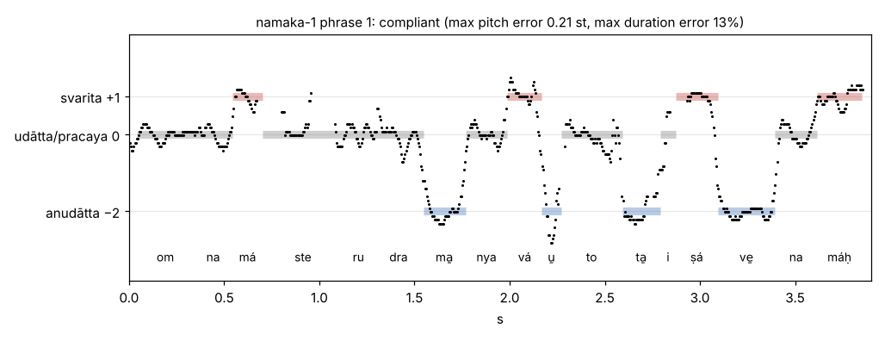

# Recitation audio

Voice: AI4Bharat Indic Parler-TTS (speaker "Aryan"), time-stretched per syllable (Rubber Band
R3, formants preserved) and pitch-set per syllable (WORLD vocoder, spectral envelope kept).
Tempo 1 mātrā = 0.125 s. Rules: `../RULES.md`; text sources and svara cross-check: `../TEXT.md`.

A phrase is **compliant** only if, measured on the final audio, every syllable is within ±20 %
of its mātrā target (forced re-alignment) *and* within ±0.5 semitone of its svara level
(pYIN F0: anudātta −2, udātta/pracaya 0, svarita +1 semitone re 120 Hz). Non-compliant phrases
are kept (best of 5 takes) and named below; per-syllable numbers are in `reports/<unit>.json`.
The check covers timing and pitch only, **not pronunciation**; a TTS voice is an approximation
of a trained Vedic reciter.

## Full recitation (traditional order)

- [01_Namaka.mp3](01_Namaka.mp3) — Namaka (dhyAna, TS 4.5 anuvAkas 1-11, closing mantras)
- [02_Chamaka.mp3](02_Chamaka.mp3) — Camaka (TS 4.7 anuvAkas 1-11, closing mantras)

## Units

| Unit | File | Phrases compliant | Durations ok | Pitch ok | Syllables: duration ok | Syllables: pitch ok | Non-compliant phrases |
|---|---|---|---|---|---|---|---|
| dhyana-1 | [00_dhyana-1.mp3](units/00_dhyana-1.mp3) | 2/2 | 2/2 | 2/2 | 76/76 | 76/76 | — |
| dhyana-2 | [01_dhyana-2.mp3](units/01_dhyana-2.mp3) | 1/2 | 1/2 | 2/2 | 83/84 | 84/84 | 2 |
| namaka-0 | [02_namaka-0.mp3](units/02_namaka-0.mp3) | 1/1 | 1/1 | 1/1 | 10/10 | 10/10 | — |
| namaka-1 | [03_namaka-1.mp3](units/03_namaka-1.mp3) | 30/31 | 30/31 | 31/31 | 493/494 | 494/494 | 14 |
| namaka-1-shambhave | [04_namaka-1-shambhave.mp3](units/04_namaka-1-shambhave.mp3) | 4/4 | 4/4 | 4/4 | 74/74 | 74/74 | — |
| namaka-2 | [05_namaka-2.mp3](units/05_namaka-2.mp3) | 9/9 | 9/9 | 9/9 | 232/232 | 232/232 | — |
| namaka-3 | [06_namaka-3.mp3](units/06_namaka-3.mp3) | 11/12 | 12/12 | 11/12 | 274/274 | 273/274 | 9 |
| namaka-4 | [07_namaka-4.mp3](units/07_namaka-4.mp3) | 9/9 | 9/9 | 9/9 | 234/234 | 234/234 | — |
| namaka-5 | [08_namaka-5.mp3](units/08_namaka-5.mp3) | 8/8 | 8/8 | 8/8 | 176/176 | 176/176 | — |
| namaka-6 | [09_namaka-6.mp3](units/09_namaka-6.mp3) | 8/8 | 8/8 | 8/8 | 171/171 | 171/171 | — |
| namaka-7 | [10_namaka-7.mp3](units/10_namaka-7.mp3) | 6/8 | 6/8 | 7/8 | 174/176 | 175/176 | 5, 7 |
| namaka-8 | [11_namaka-8.mp3](units/11_namaka-8.mp3) | 7/8 | 8/8 | 7/8 | 183/183 | 182/183 | 8 |
| namaka-9 | [12_namaka-9.mp3](units/12_namaka-9.mp3) | 4/8 | 5/8 | 6/8 | 198/202 | 200/202 | 2, 4, 5, 6 |
| namaka-10 | [13_namaka-10.mp3](units/13_namaka-10.mp3) | 24/24 | 24/24 | 24/24 | 498/498 | 498/498 | — |
| namaka-11 | [14_namaka-11.mp3](units/14_namaka-11.mp3) | 16/16 | 16/16 | 16/16 | 265/265 | 265/265 | — |
| namaka-tail | [15_namaka-tail.mp3](units/15_namaka-tail.mp3) | 14/16 | 16/16 | 14/16 | 245/245 | 242/245 | 3, 4 |
| chamaka-1 | [16_chamaka-1.mp3](units/16_chamaka-1.mp3) | 8/10 | 10/10 | 8/10 | 173/173 | 170/173 | 6, 8 |
| chamaka-2 | [17_chamaka-2.mp3](units/17_chamaka-2.mp3) | 7/8 | 8/8 | 7/8 | 163/163 | 162/163 | 1 |
| chamaka-3 | [18_chamaka-3.mp3](units/18_chamaka-3.mp3) | 8/8 | 8/8 | 8/8 | 153/153 | 153/153 | — |
| chamaka-4 | [19_chamaka-4.mp3](units/19_chamaka-4.mp3) | 8/8 | 8/8 | 8/8 | 162/162 | 162/162 | — |
| chamaka-5 | [20_chamaka-5.mp3](units/20_chamaka-5.mp3) | 8/8 | 8/8 | 8/8 | 150/150 | 150/150 | — |
| chamaka-6 | [21_chamaka-6.mp3](units/21_chamaka-6.mp3) | 8/8 | 8/8 | 8/8 | 172/172 | 172/172 | — |
| chamaka-7 | [22_chamaka-7.mp3](units/22_chamaka-7.mp3) | 6/8 | 8/8 | 6/8 | 150/150 | 148/150 | 1, 4 |
| chamaka-8 | [23_chamaka-8.mp3](units/23_chamaka-8.mp3) | 4/4 | 4/4 | 4/4 | 114/114 | 114/114 | — |
| chamaka-9 | [24_chamaka-9.mp3](units/24_chamaka-9.mp3) | 4/4 | 4/4 | 4/4 | 108/108 | 108/108 | — |
| chamaka-10 | [25_chamaka-10.mp3](units/25_chamaka-10.mp3) | 7/8 | 8/8 | 7/8 | 171/171 | 170/171 | 1 |
| chamaka-11 | [26_chamaka-11.mp3](units/26_chamaka-11.mp3) | 8/8 | 8/8 | 8/8 | 205/205 | 205/205 | — |
| chamaka-tail | [27_chamaka-tail.mp3](units/27_chamaka-tail.mp3) | 5/5 | 5/5 | 5/5 | 105/105 | 105/105 | — |
| **total** | | **235/253** | | | **5212/5220** | **5205/5220** | |

The pilot ([00_PILOT_Dhyana-Namaka-anuvaka-1.mp3](00_PILOT_Dhyana-Namaka-anuvaka-1.mp3), `reports/pilot.json`) is the listening test made before the full render; its phrases are reused in the units above.

